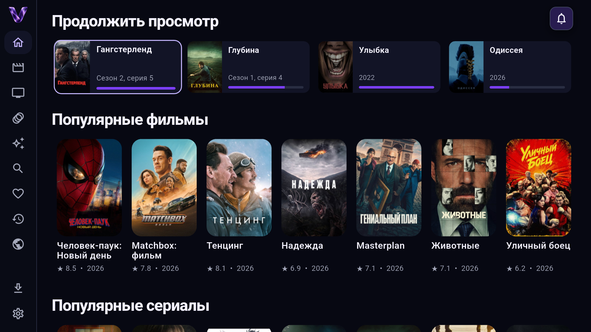
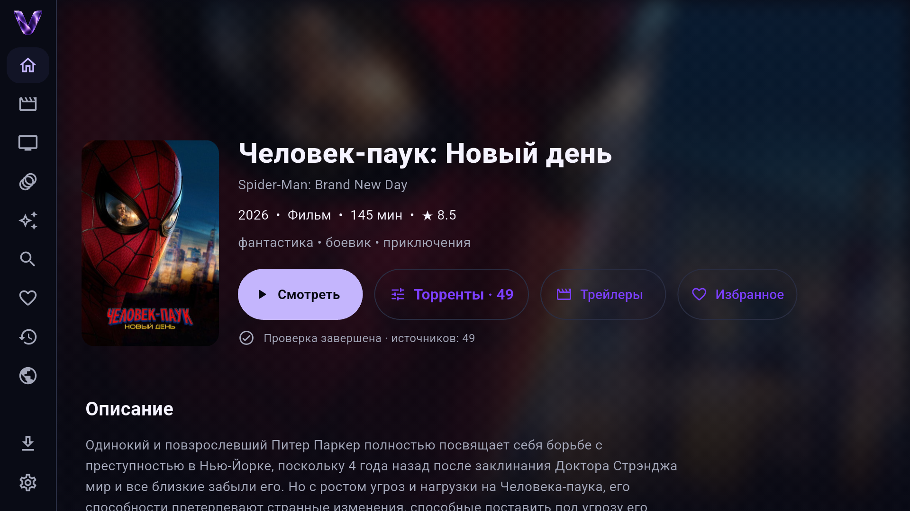

  

<h1 align="center">VOXO</h1>

<strong>Кино. В вашем ритме.</strong> Фильмы, сериалы, мультфильмы и аниме — на большом экране и в телефоне.

  <a href="https://github.com/voxo-app/voxo/releases/latest/download/voxo-android-tv.apk"><strong>Скачать для Android TV</strong></a>
  &nbsp; · &nbsp;
  <a href="https://github.com/voxo-app/voxo/releases/latest/download/voxo-android-mobile.apk"><strong>Скачать для Android</strong></a>
  &nbsp; · &nbsp;
  <a href="https://github.com/voxo-app/voxo/releases/latest">Что нового</a>

---

VOXO объединяет каталог, поиск источников и плеер в одном приложении.
Выбирайте онлайн-видео или торрент, сохраняйте любимое и возвращайтесь к просмотру с последней позиции.
Для Android не нужно разворачивать собственный медиасервер.

## Ваш следующий фильм — уже здесь

- **Каталог на любой вечер.** Фильмы, сериалы, мультфильмы и аниме в отдельных разделах.
- **Поиск и фильтры.** Ищите по названию, выбирайте жанр, страну, год и рейтинг.
- **Продолжить просмотр.** Недосмотренные фильмы и серии доступны прямо с главной.
- **Избранное.** Собирайте собственный список того, что хочется посмотреть.
- **Новости кино и сериалов.** Читайте новости внутри приложения.

## Одна карточка — несколько способов смотреть

| Возможность | Как это работает |
| --- | --- |
| **Смотреть** | Онлайн-видео через HLS. Доступные качества видны в списке, а менять качество можно прямо в плеере. |
| **Торренты** | Поиск по нескольким трекерам, выбор раздачи по качеству, размеру и доступным пирам. Встроенный torrent engine работает на устройстве. |
| **Трейлеры** | Отдельная кнопка для знакомства с фильмом перед просмотром. |
| **Сериалы** | Выбор сезона и серии для онлайн-просмотра, переключение эпизодов в плеере и настраиваемый автопереход к следующей серии. |
| **Актёры** | Откройте актёра в карточке и переходите к его фильмографии с фильтрами «Фильмы» и «Сериалы». |
| **История** | Онлайн-видео и торренты сохраняют прогресс. Из истории открывается карточка с кнопкой «Продолжить». Для торрентов можно заново выбрать раздачу. |

## Плеер под рукой

Управление с пульта на ТВ и сенсорное управление на телефоне: пауза, перемотка,
выбор эпизода, аудиодорожки и субтитров, если они доступны в источнике.
Есть настройка скорости воспроизведения и таймер сна.

Для HLS доступно переключение качества. Для торрентов качество выбирается вместе
с раздачей. Воспроизведение 4K, HDR и многоканального звука зависит от источника,
возможностей устройства и подключённой аудиосистемы.

## Скачайте заранее — смотрите без интернета

- **Онлайн-видео:** включите «Офлайн» в окне «Смотреть», выберите видео и папку сохранения.
- **Торренты на телефоне:** нажмите «Скачать» у раздачи и выберите нужные файлы.
- **Порядок в загрузках:** одна торрент-закачка — одна папка; очередь и сохранённые видео собраны в разделе «Загрузки».
- **Офлайн на ТВ:** для скачивания онлайн-видео нужен USB-накопитель или SD-карта.

Скачанное HLS-видео хранится комплектом файлов в своей папке и открывается через VOXO.
Чтобы сохранить возможность просмотра, не удаляйте отдельные файлы этого комплекта.

## Установка и обновления

| Устройство | Сборка |
| --- | --- |
| Android TV / Google TV, телевизоры и приставки | [voxo-android-tv.apk](https://github.com/voxo-app/voxo/releases/latest/download/voxo-android-tv.apk) |
| Android-телефоны и планшеты | [voxo-android-mobile.apk](https://github.com/voxo-app/voxo/releases/latest/download/voxo-android-mobile.apk) |

1. Скачайте APK для своего устройства. Опубликованные сборки предназначены для Android 7.0+ на ARM.
2. Откройте APK и разрешите установку из выбранного источника, если Android попросит.
3. Запустите VOXO и выберите фильм или сериал.

Приложение сообщает о новой версии и подготавливает обновление в фоне, пока вы
пользуетесь интерфейсом. Установка запускается кнопкой «Обновить» с системным
подтверждением Android. После установки откройте VOXO снова.

[Все релизы и заметки об изменениях](https://github.com/voxo-app/voxo/releases) ·
[Контрольные суммы последнего релиза](https://github.com/voxo-app/voxo/releases/latest/download/SHA256SUMS.txt)

## Полезно знать

- Доступность видео, озвучек, качества и субтитров зависит от источника. Наличие карточки в каталоге не означает наличие видео для просмотра.
- Избранное и история хранятся на устройстве; синхронизации между устройствами пока нет.
- В текущем публичном релизе доступны Android TV и Android Mobile. Веб-версия и приложение для iPad пока не опубликованы.

Скриншоты сделаны на Android TV в VOXO 0.7.13, 19 октября 2026 года.

---

Этот репозиторий содержит публичные релизы, обновления и материалы VOXO.
